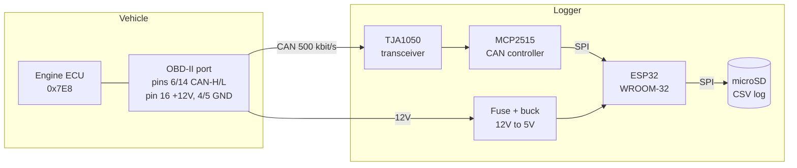

# ESP32 OBD-II CAN Logger

[](https://github.com/tangoferrari17/esp32-obd2-can-logger/actions/workflows/ci.yml)

A standalone vehicle data logger that connects straight to a car's diagnostic CAN bus. It runs on an **ESP32**, talks to the bus through an **MCP2515 CAN controller and TJA1050 transceiver**, and writes timestamped engine and vehicle data to a **microSD card**.

The point is to speak the protocol directly instead of hiding it behind an ELM327 dongle. The firmware builds every ISO 15765-4 frame itself, validates each response byte by byte, and logs failures as data rather than dropping them.

> **Status:** Fall 2026 semester project, in progress. Hardware is wired and the SD logging path works on the bench. The OBD-II protocol layer is unit-tested in CI. Vehicle testing is the next milestone. See the [roadmap](#roadmap) below.

---

## System overview



**Request/response cycle (SAE J1979 Mode 01 over ISO 15765-4):**

| Step | CAN ID | Data bytes | Meaning |
|---|---|---|---|
| Request | `0x7DF` (functional, broadcast) | `02 01 0C 00 00 00 00 00` | 2 bytes follow: service 01, PID 0x0C (RPM) |
| Response | `0x7E8` (engine ECU) | `04 41 0C 1A F8 00 00 00` | 4 bytes follow: 0x41 = positive reply to 01, PID 0C, A=0x1A, B=0xF8 |
| Decode | | | RPM = (A·256 + B) / 4 = **1726 rpm** |

## Logged parameters

| PID | Parameter | Formula | Unit |
|---|---|---|---|
| `0x0C` | Engine RPM | (A·256 + B) / 4 | rpm |
| `0x0D` | Vehicle speed | A | km/h |
| `0x05` | Coolant temperature | A − 40 | °C |
| `0x11` | Throttle position | A · 100 / 255 | % |
| `0x0F` | Intake air temperature | A − 40 | °C |
| `0x10` | MAF air flow rate | (A·256 + B) / 100 | g/s |

## Log format

One CSV per power cycle (`/log_000.csv`, `/log_001.csv`, …). Every request produces a row, **including failures**, so dropouts show up in the data rather than vanishing from it:

```csv
ms,pid,name,value,unit,ecu,raw_hex,status
10432,0x0C,engine_rpm,1726.00,rpm,0,04 41 0C 1A F8 00 00 00,ok
10447,0x0D,vehicle_speed,0.00,km/h,0,03 41 0D 00 00 00 00 00,ok
10560,0x10,maf_rate,,,,,timeout
```

## Hardware

| Part | Role | Interface |
|---|---|---|
| ESP32 DevKit (WROOM-32) | Main controller | — |
| MCP2515 + TJA1050 module | CAN controller + transceiver | SPI |
| OBD-II male pigtail | Physical tap into the diagnostic port | CAN-H/L, 12V, GND |
| microSD breakout + card | Data storage | SPI (shared bus) |
| SSD1306 0.96" OLED | Live readout *(planned)* | I²C |
| NEO-6M GPS | Position and speed reference *(planned)* | UART |
| Buck converter 12V→5V + inline 1–2 A fuse | Vehicle power *(planned)* | — |

### Wiring

| ESP32 pin | Connects to | Notes |
|---|---|---|
| GPIO 18 | MCP2515 SCK, SD SCK | Shared SPI clock |
| GPIO 19 | MCP2515 SO, SD MISO | Shared SPI MISO |
| GPIO 23 | MCP2515 SI, SD MOSI | Shared SPI MOSI |
| GPIO 5 | MCP2515 CS | |
| GPIO 15 | SD CS | |
| 5V / GND | MCP2515 VCC / GND, SD VCC / GND | |

| OBD-II pin | Signal | Goes to |
|---|---|---|
| 6 | CAN-H | MCP2515 module CAN-H |
| 14 | CAN-L | MCP2515 module CAN-L |
| 16 | +12V (unswitched, always live) | Inline fuse → buck converter input |
| 4, 5 | Chassis / signal ground | Common ground |

Pin assignments live in [`firmware/include/config.h`](firmware/include/config.h).

## Design decisions

- **Raw CAN instead of an ELM327 dongle.** The dongle hides framing, arbitration IDs, padding and error responses. Building the frames directly means understanding the bus, which was the point of the project.
- **The protocol layer is hardware-independent.** [`firmware/lib/obd2`](firmware/lib/obd2) has no Arduino or MCP2515 dependencies. Frame construction and response parsing are unit-tested on a laptop and in CI before anything is transmitted onto a real vehicle bus.
- **Loopback self-test at boot.** The MCP2515 sends a frame to itself in loopback mode before it is allowed onto the bus. A wiring fault or wrong crystal setting halts the logger instead of putting malformed traffic on a car network.
- **Strict response validation.** Responses are checked for the ID range (0x7E8–0x7EF), ISO-TP single-frame PCI, length consistency, the 0x7F negative response, mode echo (0x41) and PID echo. A late reply to an earlier request is discarded, not misattributed.
- **Hardware acceptance filters.** The MCP2515 masks pass only 0x7E8–0x7EF, so unrelated traffic never reaches the CPU.
- **Errors are data.** Timeouts, TX errors and rejected responses become rows in the CSV, so a drive log shows *where* communication degraded.
- **Bounded data loss.** The SD file is flushed every 20 lines. A power cut costs at most that many rows, not the whole file.

## Safety

- First connection to any vehicle: **parked, parking brake set, ignition on, engine off or idling.**
- The logger sends only standard diagnostic requests on `0x7DF`. The OBD-II port exposes the diagnostic bus through the gateway, not the powertrain or comfort buses directly.
- The 12V tap on pin 16 is **fused** and **unswitched**, so the logger is unplugged between sessions to avoid draining the battery.

## Test vehicles

Development started on a 2018 VW Tiguan (EA888 Gen 3, Aisin 8-speed), which has since been retired. Vehicle testing continues on a borrowed car. Every US-market car from model year 2008 on is required to support ISO 15765-4 CAN on OBD-II pins 6/14, so the firmware is vehicle-agnostic. Each session goes in [`docs/test-log.md`](docs/test-log.md).

## Build and test

Requires [PlatformIO](https://platformio.org/) (CLI or the VS Code extension).

```bash
cd firmware
pio test -e native             # protocol unit tests on your machine, no hardware needed
pio run -e esp32dev            # build firmware
pio run -e esp32dev -t upload  # flash
pio device monitor             # 115200 baud
```

> Check the crystal on your MCP2515 module (it's printed on the metal can). Most blue modules are **8 MHz**. If yours is 16 MHz, change `CAN_CRYSTAL` in `config.h`, or the bitrate will be wrong and nothing will answer.

## Roadmap

- [x] ESP32 toolchain, test sketches running
- [x] Hardware wired on breadboard; SD module soldered, read/write verified
- [x] OBD-II protocol layer + unit tests in CI
- [x] Logger firmware: loopback self-test, PID polling, CSV logging
- [x] MCP2515 loopback verified on hardware
- [ ] First vehicle connection: RPM request → real response
- [ ] Full PID set logged during an idle session
- [ ] OLED live display
- [ ] GPS position/speed logged alongside CAN data
- [ ] Self-powered from the vehicle (fused 12V + buck converter)
- [ ] Logged drive + plotted dataset (RPM / speed / coolant over time)
- [ ] Hardening: CAN timeouts, SD write errors, power blips
- [ ] Stretch: manufacturer-specific UDS (service 0x22) parameters, e.g. boost pressure

## License

MIT
